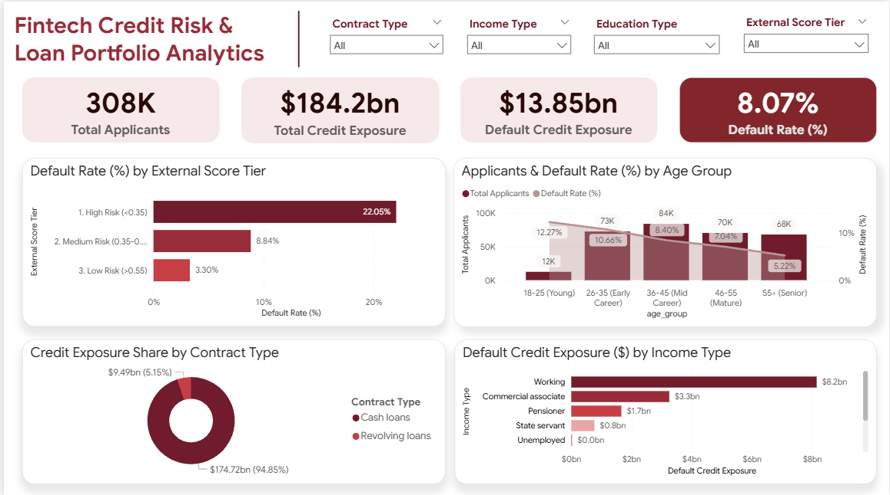
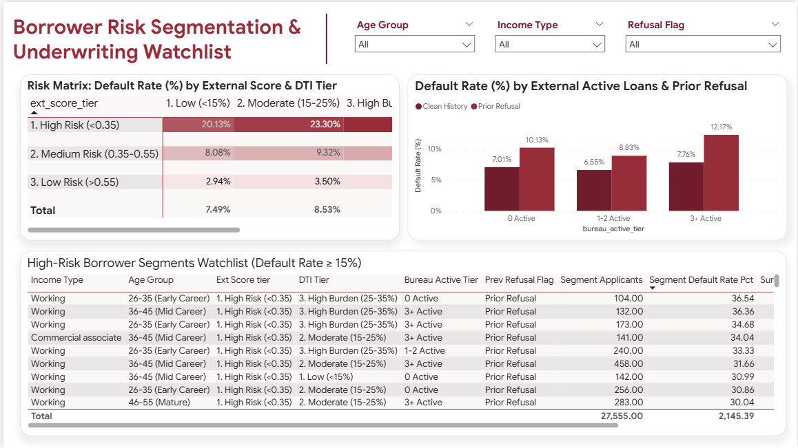
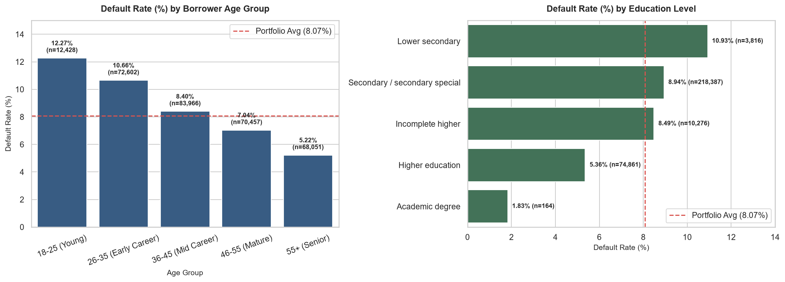
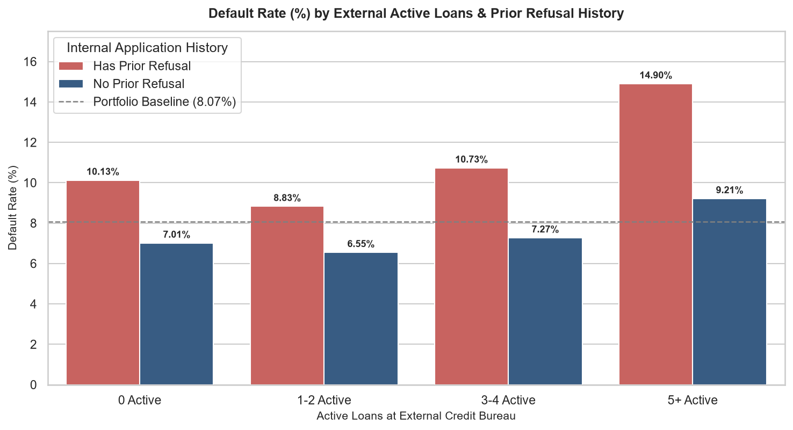

# Fintech Credit Risk Analytics: Loan Default Patterns, Borrower Segmentation & Portfolio Risk Assessment

[](https://www.python.org/)
[](https://www.postgresql.org/)
[](https://powerbi.microsoft.com/)


## Project Overview
Proyek ini berfokus pada analisis kesehatan portofolio kredit, identifikasi pola serta faktor pendorong gagal bayar (*loan default*), dan perumusan rekomendasi kebijakan persetujuan kredit (*underwriting policy*) berbasis data.

Analisis dilakukan secara *end-to-end* menggunakan pendekatan **Relational SQL Modeling**, **Exploratory Data Analysis (EDA)**, **Statistical Hypothesis Testing**, dan **Executive Power BI Dashboarding** pada **307.504 aplikasi pinjaman** yang diintegrasikan dengan **3,38 juta catatan riwayat kredit**.
---

## Key Portfolio Metrics
* **Total Active Applicants:** `307,504` nasabah
* **Total Credit Exposure:** `$184.20 Billion`
* **Overall Default Rate:** `8.07%` (`24,824` debitur gagal bayar)
* **Default Credit Exposure:** `$13.85 Billion` (`7.52%` dari total portofolio)
* **Primary Risk Driver:** Skor kredit eksternal (`avg_ext_source`, Cramér's $V = 0.2136$, $p < 0.0001$)

---

## Interactive Power BI Dashboard

### Page 1: Executive Credit Portfolio & Default Overview


### Page 2: Borrower Risk Segmentation & Underwriting Watchlist


---

## Data Architecture & Workflow
1. **Data Audit & Cleaning (`notebooks/01` & `02`):**
   * Menangani anomali sistem `DAYS_EMPLOYED = 365243` (18,01% baris pensiunan), menghapus *outlier* pendapatan ekstrem (`>$10M`), dan melakukan imputasi berbasis grup.
   * Meringkas `1.716.428` baris riwayat biro kredit (`HC_bureau`) dan `1.670.214` baris riwayat pengajuan internal (`HC_previous_application`) ke granularitas per nasabah (`sk_id_curr`).
2. **PostgreSQL Relational Database (`sql/`):**
   * Merancang skema relasional 3 tabel (`fact_applications`, `dim_bureau_history`, `dim_prev_applications`) lengkap dengan *Primary/Foreign Keys*, *Indexing*, serta *Analytical Views* (`vw_credit_portfolio_summary` & `vw_high_risk_watchlist`).
3. **Exploratory & Statistical Risk Analysis (`notebooks/03` & `04`):**
   * Membuktikan signifikansi pola risiko menggunakan uji non-parametrik **Chi-Square ($\chi^2$ + Cramér's V)**, **Mann-Whitney U**, dan **Kruskal-Wallis H** ($\alpha = 0,05$).

### Key Statistical & Visual Insights
| Default Rate by Age & Education | External Loans & Prior Refusal Impact |
| :---: | :---: |
|  |  |

---

## Repository Structure
```text
project-2-fintech-credit-risk/
├── docs/
│   ├── data_dictionary.md               # Definisi variabel & temuan audit data
│   ├── kpi_dictionary.md                # Rumus standar KPI risiko kredit
│   └── risk_strategy_report.md          # Laporan eksekutif & rekomendasi kebijakan kredit
├── figures/                             # Grafik analisis Python & screenshot Power BI
├── notebooks/
│   ├── 01_data_understanding_and_audit.ipynb
│   ├── 02_data_cleaning_and_feature_eng.ipynb
│   ├── 03_eda_risk_analysis.ipynb
│   └── 04_statistical_risk_analysis.ipynb
├── powerbi/
│   └── home_credit_risk_dashboard.pbix  # File interaktif dashboard Power BI (2 Halaman)
├── sql/
│   ├── 01_schema_and_load.sql           # DDL tabel relasional, Foreign Keys, & Index
│   ├── 02_portfolio_and_history_kpi.sql # Query KPI portofolio & analisis multi-tabel
│   └── 03_risk_segmentation_views.sql   # Analytical Views untuk Power BI
├── .gitignore
├── README.md
└── requirements.txt